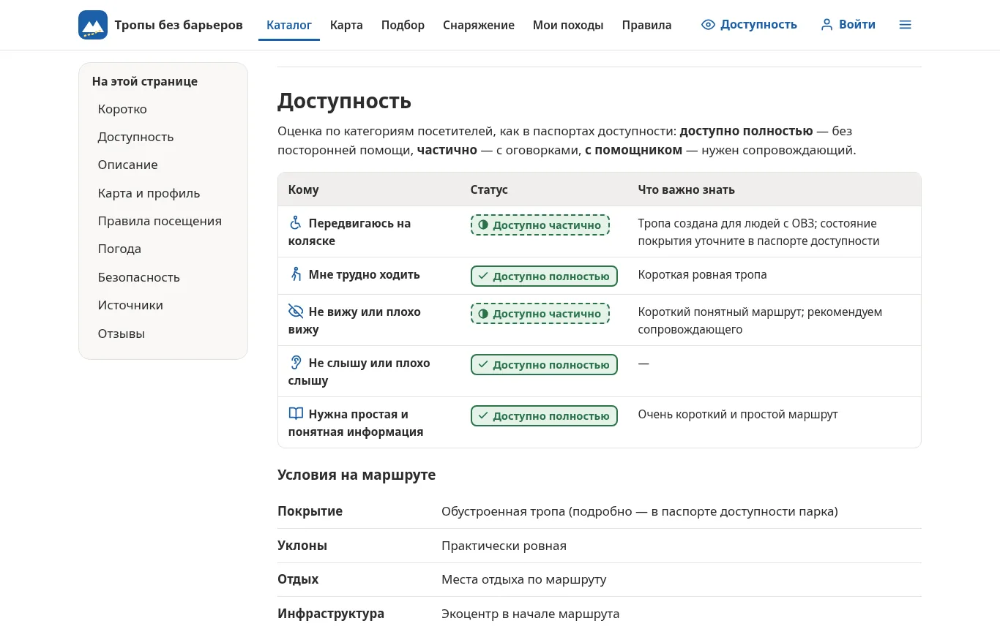
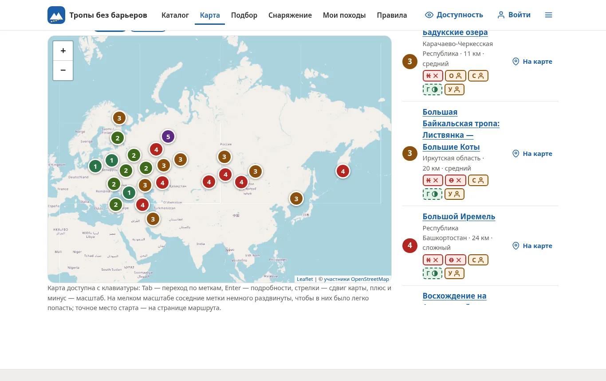
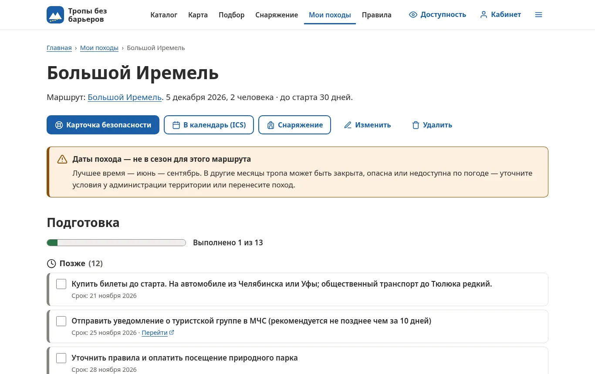
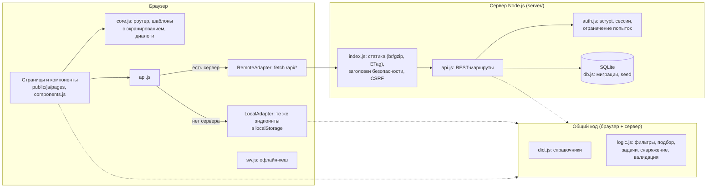
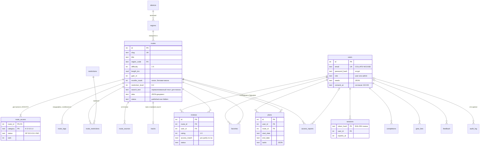

# Тропы без барьеров

**Сервис, который помогает выбрать и спланировать пеший маршрут по России — с учётом здоровья, опыта и правил посещения природных территорий.** Сделан для всех, в том числе для людей с инвалидностью и ограниченными возможностями здоровья (ОВЗ), пожилых путешественников и семей с детьми.


| | |
|---|---|
| **Стек** | Node.js ≥ 22.13 (встроенные `node:http`, `node:sqlite`, `node:crypto`) · Vanilla JS · CSS · Leaflet 1.9 |
| **Зависимости** | нет — `npm install` не нужен |
| **Данные** | 25 маршрутов в 19 регионах и 8 федеральных округах · 14 правил посещения с законами и официальными ссылками · 74 позиции снаряжения |
| **Проверки** | 90 автотестов (`npm test`) · самопроверка проекта (`npm run check`) · axe-core без нарушений WCAG 2.2 AA |
| **Режимы** | сервер с базой данных **или** один HTML-файл без сервера (`dist/tropy-standalone.html`) |

## Содержание

1. [Быстрый старт](#быстрый-старт)
2. [Что умеет сайт](#что-умеет-сайт)
3. [Доступность](#доступность)
4. [Архитектура](#архитектура)
5. [База данных](#база-данных)
6. [API](#api)
7. [Безопасность и персональные данные](#безопасность-и-персональные-данные)
8. [Тестирование](#тестирование)
9. [Настройка](#настройка)
10. [Размещение в интернете](#размещение-в-интернете)
11. [Структура проекта](#структура-проекта)
12. [Источники данных и лицензии](#источники-данных-и-лицензии)

Дополнительно: [презентация проекта](docs/PRESENTATION.md) · [доступность](docs/ACCESSIBILITY.md) · [API](docs/API.md) · [данные](docs/DATA.md) · [тестирование](docs/TESTING.md).

## Быстрый старт

Нужен только [Node.js](https://nodejs.org/) версии **22.13 или новее** (проверить: `node -v`).

```bash
cd tropy
npm start            # или: node server/index.js
```

Откройте <http://localhost:3000>. При первом запуске создаётся база `data/tropy.db` и заполняется маршрутами.

| Демо-доступ | Почта | Пароль |
|---|---|---|
| Пользователь | `demo@tropy.local` | `Demo-2026` |
| Администратор | `admin@tropy.local` | `Tropy-Admin-2026` |

Демо-пользователь создаётся всегда (отключить — `DEMO_USER=0`). Пароль администратора по умолчанию действует только вне рабочего режима: при `NODE_ENV=production` задайте свой `ADMIN_PASSWORD` — см. [Настройка](#настройка).

**Без сервера.** Откройте файл `dist/tropy-standalone.html` в любом современном браузере — сайт заработает целиком: каталог, карта, подбор, кабинет и администрирование. Данные аккаунтов в этом режиме хранятся только в браузере (localStorage). Пересобрать файл: `npm run build:standalone`.

Другие команды:

```bash
npm run dev               # запуск с автоперезапуском при изменении кода и журналом запросов
npm test                  # 90 автотестов: API, база, безопасность, логика подбора, данные
npm run check             # синтаксис всех файлов, ссылки, офлайн-кеш, обложки и треки
npm run build:standalone  # сборка сайта в один HTML-файл
```

## Что умеет сайт

| Раздел | Возможности |
|---|---|
| **Каталог** | Поиск по названию, региону и месту; фильтры: кому доступно (5 категорий), сложность 1–5, длина, один или несколько дней, федеральный округ и регион, месяц, ландшафт, особенности (вода, вид, ночёвка…), «без разрешений»; сортировка по доступности, сложности, длине, оценкам и названию. Фильтры сохраняются в адресе страницы — подборкой можно поделиться. |
| **Страница маршрута** | Паспорт доступности по 5 категориям, условия на тропе (покрытие, уклоны, места отдыха, инфраструктура), текст «Коротко и простыми словами», тифлокомментарий для незрячих, этапы, карта с треком и профиль высот (таблица — альтернатива графику), прогноз погоды у старта, правила посещения с официальными ссылками, советы по безопасности, отзывы с оценкой «совпала ли доступность», кнопка «Сообщить о неточности в доступности», трек GPX, печать, «Поделиться», озвучивание. |
| **Подбор маршрута** | 4 шага: кто идёт и что важно учесть → подготовка → сколько времени и когда → где и что хочется увидеть. Результат — маршруты с объяснением, *почему* они подходят и о чём предупредить. |
| **Карта** | Все маршруты на карте России: метки с номером сложности и цветом, фильтры, «ближайшие ко мне»; рядом — тот же список текстом. Карта управляется с клавиатуры. |
| **Снаряжение** | Список вещей под конкретный маршрут, сезон, длительность и участников (коляска, трудности с ходьбой, нарушения зрения или слуха, дети, пожилые, собака-проводник) и тип ночёвки: объяснение, зачем нужна каждая вещь, вес, отметки «собрано», печать и сохранение в кабинете. |
| **Мои походы** | План похода: даты, группа, контакт на случай ЧС. Сайт сам составляет список задач подготовки со сроками (билеты, пропуск в погранзону, уведомление МЧС, прививка от клеща…), предупреждает, если даты вне сезона, выгружает план в календарь (ICS) и печатает **карточку безопасности** для близких. |
| **Правила и источники** | База знаний: заповедники, нацпарки, погранзона, уведомление МЧС, пожароопасный сезон, клещи, гиды, права людей с собакой-проводником — с ссылками на законы и официальные сайты. Срочные объявления (закрытия троп) показываются вверху сайта. |
| **Сравнение** | До 3 маршрутов рядом: доступность, длина, время, сезон, разрешения. |
| **Кабинет** | Регистрация с согласием на обработку данных, вход «запомнить меня», профиль с особенностями здоровья (для подбора по умолчанию), избранное, пройденные маршруты, отзывы, смена пароля, выгрузка всех своих данных (JSON), удаление аккаунта. |
| **Администрирование** | Сводка, маршруты (создание и правка с проверкой данных, скрытие), модерация отзывов, сообщения о барьерах со статусами, обратная связь, пользователи и роли, срочные объявления, журнал действий. |
| **Офлайн** | Сайт устанавливается как приложение (PWA) и открывается без интернета: каталог, правила и сохранённые страницы доступны в горах без связи. |

<p>




</p>

## Доступность

Доступность — не отдельная «версия для слабовидящих», а свойство всего сайта. Подробно — в [docs/ACCESSIBILITY.md](docs/ACCESSIBILITY.md).

- **Панель настроек по ГОСТ Р 52872-2019**: размер текста до 200 %, 8 цветовых схем (в том числе чёрно-белая, белым по чёрному, синяя, коричневая, зелёная), межбуквенный и межстрочный интервал, шрифт с засечками или удобочитаемый, картинки — показывать, чёрно-белые или скрыть, отключение анимации, выделение ссылок, упрощённый вид, озвучивание текста. Настройки применяются до отрисовки страницы и сохраняются.
- **WCAG 2.2 AA**: проверено axe-core на всех страницах — на телефоне и компьютере, в светлой и тёмной теме, при шрифте 200 %; контраст всех пар цветов ≥ 4,5 : 1; цель касания ≥ 24 px (кнопки — 44 px).
- **Клавиатура и экранные читалки**: ссылки «Перейти к содержанию», ориентиры (landmarks), фокус переносится на заголовок новой страницы, объявления через `aria-live`, ошибки форм связаны с полями и собираются в сводку, у карты — полная текстовая альтернатива, у графика высот — таблица.
- **Понятный язык**: у каждого маршрута есть «Коротко и простыми словами» и тифлокомментарий; статусы доступности дублируются текстом и иконкой, не только цветом.
- **Категории как в паспортах доступности** (К, О, С, Г, У — приказ Минтруда России № 627): коляска, трудно ходить, зрение, слух, нужна простая информация.

## Архитектура



Ключевые решения:

- **Ноль зависимостей.** Сервер написан на встроенных модулях Node.js, база — встроенный `node:sqlite`. Проект запускается одной командой, нет уязвимостей в сторонних пакетах, нечего обновлять.
- **Одна логика для браузера и сервера.** Фильтрация, подбор, генерация задач, список снаряжения и **валидация данных** (`public/js/shared/logic.js`) работают одинаково на клиенте и на сервере. Тесты проверяют, что SQL-фильтры сервера дают тот же результат, что и клиентская логика.
- **Два адаптера данных с одним интерфейсом.** `api.js` сам определяет, есть ли сервер. Если нет — те же эндпоинты обслуживает `LocalAdapter` в браузере. Поэтому один и тот же код работает и на сервере, и как файл с диска, и на бесплатном статическом хостинге.
- **Без сборщика.** Обычные скрипты в порядке зависимостей и маршрутизация через `#/адрес` — сайт можно открыть даже с файловой системы. Шаблоны — tagged template `html\`\``, который **экранирует все подставляемые значения** (защита от XSS по умолчанию).

## База данных

SQLite, схема в [`server/db.js`](server/db.js), миграции применяются по порядку и один раз (таблица `schema_migrations`). Модель «реляционные поля + JSON-документ»: всё, по чему фильтруем и сортируем, лежит в колонках и связанных таблицах с индексами; описание маршрута целиком — в колонке `data` (JSON). Целостность обеспечивают внешние ключи (`ON DELETE CASCADE`), `CHECK`-ограничения и уникальные индексы. Справочники (округа, регионы, правила) синхронизируются с кодом при каждом запуске.



Всего 19 таблиц; полное описание полей — в [docs/DATA.md](docs/DATA.md).

## API

REST, JSON, префикс `/api`. Полный список с параметрами и примерами — [docs/API.md](docs/API.md).

| Группа | Эндпоинты |
|---|---|
| Каталог | `GET /api/routes` (фильтры `q, need, companion, diff, lenMax, days, district, region, month, land, feat, noPermit, sort`), `GET /api/routes/:slug`, `GET /api/routes/:slug/gpx`, `GET /api/restrictions`, `GET /api/alerts`, `GET /api/open-data` |
| Аккаунт | `POST /api/auth/register`, `POST /api/auth/login`, `POST /api/auth/logout`, `GET /api/auth/me`, `PATCH /api/me`, `POST /api/me/password`, `GET /api/me/export`, `DELETE /api/me` |
| Личное | `PUT/DELETE /api/favorites/:slug`, `PUT/DELETE /api/completions/:slug`, `GET/POST/PUT/DELETE /api/plans`, `GET/POST/PUT/DELETE /api/gear-lists` |
| Участие | `POST /api/routes/:slug/reviews`, `DELETE /api/reviews/:id`, `POST /api/routes/:slug/reports`, `POST /api/feedback` |
| Администрирование | `/api/admin/stats`, `routes`, `reviews`, `reports`, `feedback`, `users`, `alerts`, `audit` |

Ошибки — единый формат `{"error": {"code": "invalid", "message": "…", "fields": {"email": "…"}}}` с понятными сообщениями на русском.

## Безопасность и персональные данные

| Угроза | Защита |
|---|---|
| Подбор и утечка паролей | scrypt (N = 16384, соль 16 байт), сравнение за постоянное время; при неизвестной почте выполняется «пустая» проверка — время ответа не выдаёт, есть ли такой пользователь |
| Кража сессии | случайный 256-битный токен в cookie `HttpOnly; SameSite=Lax` (`Secure` в рабочем режиме), в базе — только SHA-256 токена; срок 1 или 30 дней; выход и смена пароля завершают сессии |
| CSRF | изменяющие запросы требуют заголовок `X-Requested-With` и совпадение `Origin`, только `Content-Type: application/json` |
| XSS | все значения в шаблонах экранируются; ссылки из данных проходят `safeUrl` (только http/https, mailto, tel); строгая политика `Content-Security-Policy` без inline-скриптов |
| SQL-инъекции | только параметризованные запросы; в `LIKE` экранируются `%` и `_` |
| Перебор и спам | ограничение частоты для входа, регистрации и форм (ответ 429 с `Retry-After`), скрытое поле-ловушка для ботов, лимит размера тела запроса |
| Доступ к чужим данным | каждый запрос к планам и спискам проверяет владельца; админ-методы — только для роли `admin`; последнего администратора нельзя разжаловать; действия админов пишутся в журнал |
| Обход путей | статика отдаётся только из `public/`, пути нормализуются (`../` отклоняется) |
| Заголовки | CSP, `X-Content-Type-Options`, `X-Frame-Options: DENY`, `Referrer-Policy`, `Permissions-Policy`, `Cross-Origin-Opener-Policy`, HSTS при HTTPS |

**152-ФЗ.** Регистрация — только с явным согласием (дата согласия хранится). Собираем минимум данных; сведения о здоровье — по желанию и используются только для подбора. Пользователь может выгрузить все свои данные и удалить аккаунт — вместе с планами, отзывами и сессиями. Геолокация не покидает браузер. Для рабочей эксплуатации сервер с базой нужно размещать на территории России (ст. 18 152-ФЗ).

## Тестирование

```bash
npm test        # 90 тестов, ~2 секунды; база создаётся в памяти, сервер — на свободном порту
npm run check   # самопроверка перед публикацией
```

- `tests/api.test.js` — 68 тестов API: каталог и 20 комбинаций фильтров (SQL сервера = клиентская логика), регистрация и вход, сессии, профиль, экспорт и удаление данных, избранное, отзывы, планы, списки снаряжения, сообщения о барьерах, администрирование и журнал, **безопасность** (CSRF, Origin, типы содержимого, заголовки, обход путей, ловушка для ботов, права доступа, ограничение частоты).
- `tests/logic.test.js` — 22 теста: целостность данных каталога и правил, фильтры, подбор, задачи подготовки, снаряжение, валидация, экранирование в шаблонах и GPX.
- Ручная проверка доступности и сценарии для тестировщика — [docs/TESTING.md](docs/TESTING.md).

## Настройка

Все параметры — переменные окружения; значения по умолчанию подходят для локального запуска.

| Переменная | По умолчанию | Назначение |
|---|---|---|
| `PORT` | `3000` | порт HTTP-сервера |
| `HOST` | `0.0.0.0` | адрес, на котором слушает сервер |
| `DB_FILE` | `data/tropy.db` | путь к файлу базы SQLite (каталог создаётся автоматически) |
| `NODE_ENV` | — | `production` — рабочий режим: без демо-пароля администратора, cookie с флагом `Secure` |
| `ADMIN_EMAIL` | `admin@tropy.local` | почта администратора, создаваемого при первом запуске |
| `ADMIN_PASSWORD` | `Tropy-Admin-2026` (только не в production) | пароль администратора; в production обязателен |
| `DEMO_USER` | `1` | `0` — не создавать демо-пользователя |
| `DEMO_PASSWORD` | `Demo-2026` | пароль демо-пользователя |
| `TRUST_PROXY` | `0` | `1` — сервер за обратным прокси (nginx, Render): учитывать `X-Forwarded-For` и `X-Forwarded-Proto` |
| `SECURE_COOKIES` | `0` (`1` в production) | флаг `Secure` для cookie сессии |
| `LOG_REQUESTS` | `0` | `1` — писать журнал запросов в консоль |

## Размещение в интернете

**Render.com (бесплатный тариф).** В репозитории есть `render.yaml`: создайте Blueprint из репозитория — Render проверит проект (`npm run check`), запустит `npm start`, а пароль администратора сгенерирует сам (его видно в Dashboard → Environment; передайте жюри, чтобы проверить администрирование). На бесплатном тарифе диск временный: база пересоздаётся при перезапуске, для постоянного хранения подключите диск и задайте `DB_FILE=/var/data/tropy.db`.

**Docker.**

```bash
docker build -t tropy .
docker run -d -p 3000:3000 -v tropy-data:/app/data -e ADMIN_PASSWORD='сложный-пароль' tropy
```

**VPS (Ubuntu) + nginx.** Установите Node.js 22 LTS или новее, скопируйте проект и запустите как службу systemd:

```ini
# /etc/systemd/system/tropy.service
[Service]
WorkingDirectory=/opt/tropy
ExecStart=/usr/bin/node --disable-warning=ExperimentalWarning server/index.js
Environment=NODE_ENV=production PORT=3000 TRUST_PROXY=1 ADMIN_PASSWORD=сложный-пароль
Restart=always
User=www-data
[Install]
WantedBy=multi-user.target
```

В nginx — `proxy_pass http://127.0.0.1:3000;` с заголовками `X-Forwarded-For` и `X-Forwarded-Proto`, сертификат — Let's Encrypt. Резервная копия базы — `sqlite3 data/tropy.db ".backup backup.db"` или копирование файла при остановленном сервере.

**Статический хостинг (GitHub Pages, Netlify, Яндекс Object Storage).** Опубликуйте папку `public/` или один файл `dist/tropy-standalone.html` — сайт сам перейдёт в автономный режим (без общей базы: аккаунты хранятся в браузере).

## Структура проекта

```text
tropy/
├── server/                 сервер (без зависимостей)
│   ├── index.js            HTTP: статика, сжатие, кеширование, заголовки безопасности, CSRF, запуск
│   ├── api.js              REST API: каталог, аккаунт, планы, отзывы, администрирование
│   ├── auth.js             пароли (scrypt), сессии, cookie, ограничение частоты
│   └── db.js               SQLite: миграции, первичное заполнение, сохранение маршрута
├── public/                 сайт (отдаётся сервером как есть, без сборки)
│   ├── index.html          оболочка: шапка, меню, подвал, SVG-иконки, диалоги
│   ├── css/app.css         стили: дизайн-токены, темы ГОСТ, адаптивная вёрстка, печать
│   ├── js/
│   │   ├── boot.js         ранняя загрузка настроек доступности (без «мигания»)
│   │   ├── core.js         роутер, безопасные шаблоны, диалоги, уведомления, хранилище
│   │   ├── api.js          доступ к данным: сервер или автономный режим
│   │   ├── a11y.js         панель доступности и озвучивание
│   │   ├── map.js          карты Leaflet, профиль высот
│   │   ├── components.js   карточки, фильтры, паспорт доступности, формы
│   │   ├── app.js          запуск, шапка, меню, уведомления
│   │   ├── pages/          страницы: главная, каталог, маршрут, карта, подбор, снаряжение,
│   │   │                   походы, правила, сравнение, вход, кабинет, администрирование, справка
│   │   ├── shared/         общий код с сервером: справочники (dict.js) и логика (logic.js)
│   │   └── data/           маршруты, треки, правила посещения, снаряжение
│   ├── img/routes/         иллюстрации (WebP, 640 и 1280 px)
│   ├── vendor/leaflet/     Leaflet 1.9.4
│   ├── sw.js               сервис-воркер (офлайн)
│   └── manifest.webmanifest
├── tests/                  автотесты (node:test)
├── tools/                  самопроверка, сборка одного файла, подготовка треков
├── docs/                   документация и скриншоты
├── dist/                   автономная сборка tropy-standalone.html
├── Dockerfile, render.yaml развёртывание
└── package.json            команды npm
```

## Источники данных и лицензии

- Сведения о маршрутах собраны из открытых источников и с официальных сайтов ООПТ; у каждого маршрута указаны источники и дата сверки. **Правила посещения меняются** — перед поездкой проверяйте их по ссылкам на странице маршрута.
- Треки — схематичные, построены по данным © участников [OpenStreetMap](https://www.openstreetmap.org/copyright) (ODbL); высоты — [Open-Meteo](https://open-meteo.com/) (Copernicus DEM). Это не навигационные данные.
- Подложка карты — OpenStreetMap и OpenTopoMap; прогноз погоды — Open-Meteo.
- Иллюстрации созданы для проекта и не являются фотографиями конкретных маршрутов (на сайте они подписаны «Иллюстрация»).
- [Leaflet](https://leafletjs.com/) — BSD-2-Clause.
- Шрифт [PT Serif](https://www.paratype.ru/fonts/pt/pt-serif) (ПараТайп) — SIL Open Font License 1.1, текст лицензии — `public/fonts/PT-Serif-OFL.txt`.
- Код проекта — [MIT](LICENSE).
